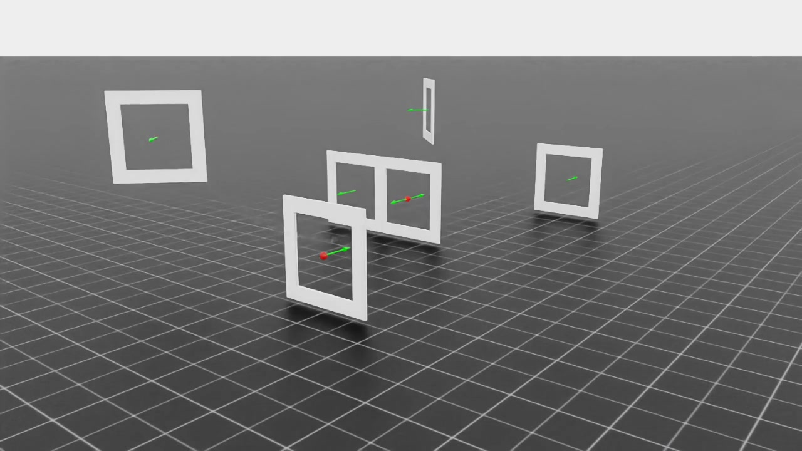
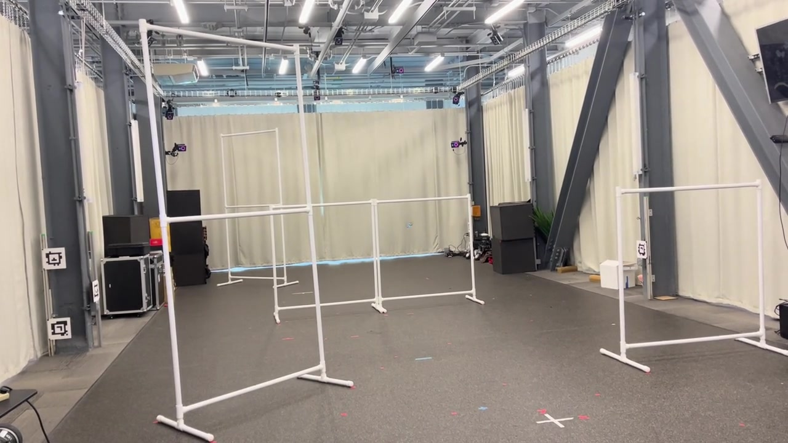

# PPO Drone Racing

**Three laps. The fastest complete race.**

A University of Pennsylvania ESE 651 Physical Intelligence project exploring how reward design changes the way a drone learns to race. We trained a Crazyflie quadcopter in NVIDIA Isaac Lab, moved from a guided power loop to a freer racing line, and refined the policy for physical flight.

[](media/version-2-alt.mp4)

## From a prescribed route to a faster line

We began with a simple goal: pass the gates in order and finish three laps as quickly as possible. The course includes adjacent gates that can be linked with a power loop: a vertical looping maneuver that carries speed while preparing for the next opening.

1. **Build a place to practice.** Isaac Lab runs many copies of the Crazyflie and course in parallel. Physics and the low-level PID controller run at 500 Hz; the learned policy sends thrust and body-rate commands at 50 Hz. Its observations include velocity, orientation, and the geometry of the current and next gates.
2. **Teach through rewards.** We implemented the PPO update in the local `rsl_rl` library. PPO collects flight experience and makes controlled policy updates, balancing an improved action policy with a learned estimate of future reward.
3. **Guide the first loop.** An elevated intermediate target encouraged the drone to fly above the gates and follow the intended loop. This first approach completed the simulated three-lap race in approximately **21 seconds**.
4. **Give speed more freedom.** We shifted the emphasis toward useful forward velocity and let the policy discover its own trajectory. The later simulation demonstration reached approximately **19 seconds**.
5. **Prepare for real flight.** We varied the simulated vehicle's dynamics and refined gate approaches so the policy would be less dependent on one idealized drone.

| Stage | Footage |
| --- | --- |
| Version 1: guided loop, ~21 s | [Main view](media/version-1.mp4) · [Alternate angle](media/version-1-alt.mp4) |
| Version 2: freer racing line, ~19 s | [Main view](media/version-2.mp4) · [Alternate angle](media/version-2-alt.mp4) |
| Physical flight | [Watch the real drone](media/real-flight.mp4) |

These are approximate times from the project demonstrations, not a standardized benchmark. The physical flight is a separate demonstration and does not share the simulation timing claim. The clips show representative stages; the current source includes later hardware refinements and is not an exact checkpoint of every video. Trained weights and experiment logs are excluded from this repository.

## What changed in the learning code

The reward is how we tell the drone what a good race looks like. We adjusted the strength of these signals as training progressed:

| Signal | Intended behavior |
| --- | --- |
| Progress toward the next gate | Give useful feedback before a full lap is completed. |
| Valid gate crossing | Reward passing through the opening and advance to the next target. |
| Velocity toward current and upcoming gates | Encourage speed that helps the race, with some anticipation of the next turn. |
| Cost per step until three laps are complete | Make waiting and unnecessary detours expensive. |
| Roll, pitch, and yaw command penalties | Balance fast turns with controllable motion. |
| Crashes and backward crossings | Make failed or invalid routes costly. |
| Height error near a gate | Help later policies arrive at the opening at the right altitude. |

The local PPO implementation includes the clipped policy objective, value loss, gradient clipping, and an adaptive learning rate based on policy change. The environment also supports look-ahead gate observations and curriculum resets from stored successful flight states, giving the learner practice beyond the starting line.

## Making simulation less perfect

For sim-to-real preparation, the training configuration varies thrust, aerodynamic drag, and PID gains. A command must work across a range of vehicle responses instead of relying on one exact simulator model.

| Parameter | Active training range, relative to its base value |
| --- | --- |
| Thrust-to-weight ratio | 0.90–1.10× |
| Horizontal and vertical drag | 0.4–2.3× |
| Roll/pitch and yaw proportional/integral gains | 0.80–1.20× |
| Roll/pitch and yaw derivative gains | 0.65–1.35× |

Spawn locations are also varied. Configurable observation noise was added for velocity, attitude, and gate geometry, but **all observation-noise standard deviations are zero in the current training configuration**. Motor time constants remain fixed.

[](media/real-flight.mp4)

## Working with the code

The project was developed with Isaac Sim 4.5, the course's Isaac Lab setup, a Python 3.10 Conda environment, CUDA-enabled PyTorch, and the vendored `rsl_rl` implementation. Install and configure that compatible Isaac Lab environment first. The repository does not include Isaac Sim or Isaac Lab, and it is not a self-contained training installation.

Keep the project beside the Isaac Lab checkout, following the course setup:

```text
workspace/
├── IsaacLab/
└── PPO-Drone-Racing/
```

Run from the repository root so that the `usd/` assets resolve correctly. In an already configured Isaac Lab environment, the following Bash commands expose the project imports and install the local learning library:

```bash
git clone https://github.com/kaifanyu/PPO-Drone-Racing.git
cd PPO-Drone-Racing
conda activate isaac_quad_sim2real
export PYTHONPATH="$PWD${PYTHONPATH:+:$PYTHONPATH}"
python -m pip install -e src/third_parties/rsl_rl_local

python scripts/rsl_rl/train_race.py \
    --task Isaac-Quadcopter-Race-v0 \
    --num_envs 8192 \
    --max_iterations 5000 \
    --logger tensorboard \
    --headless
```

Use your actual Conda environment name and reduce `--num_envs` to fit your GPU. Both entry points prioritize `src/third_parties/rsl_rl_local`; installing a different upstream `rsl_rl` alone will not provide this project's PPO changes. GPU training has not been re-run as part of preparing this public repository.

Training writes runs under `logs/rsl_rl/quadcopter_direct/`. The historical evaluation script, `scripts/rsl_rl/play_race.py`, accepts `--load_run`, `--checkpoint`, `--video`, `--time_laps`, and `--end_after_laps`. It currently needs the training reward configuration supplied to `env_cfg.rewards` before environment creation; it does not automatically restore that configuration from a run. Evaluation also requires your own compatible trained checkpoint.

Useful starting points:

- [`train_race.py`](scripts/rsl_rl/train_race.py): reward weights, randomization ranges, spawn settings, and training entry point.
- [`quadcopter_strategies.py`](src/isaac_quad_sim2real/tasks/race/config/crazyflie/quadcopter_strategies.py): rewards, observations, gate logic, curriculum resets, and dynamics randomization.
- [`quadcopter_env.py`](src/isaac_quad_sim2real/tasks/race/config/crazyflie/quadcopter_env.py): vehicle model, track geometry, physics, and control.
- [`ppo.py`](src/third_parties/rsl_rl_local/rsl_rl/algorithms/ppo.py): the PPO update.

The batch and fine-tuning shell scripts retain experiment-specific paths and settings; adapt them to your environment before use.

## Credits and licenses

Developed for **Penn ESE 651: Physical Intelligence**, building on the course project and its contributors in [vineetpasumarti/ese651_project](https://github.com/vineetpasumarti/ese651_project) and [Epicrider/ese651_project](https://github.com/Epicrider/ese651_project). The simulation and learning stack build on [NVIDIA Isaac Lab](https://github.com/isaac-sim/IsaacLab) and [rsl_rl](https://github.com/leggedrobotics/rsl_rl).

Original history, attribution, and license notices are retained. See the repository's [LICENSE](LICENSE), the vendored [rsl_rl license](src/third_parties/rsl_rl_local/LICENSE), and the notices in individual source files.
